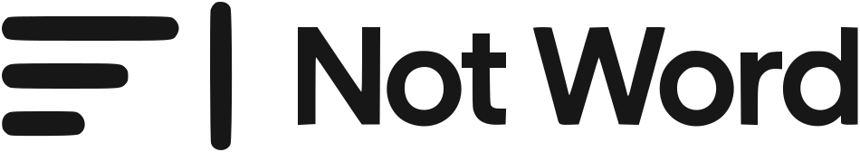
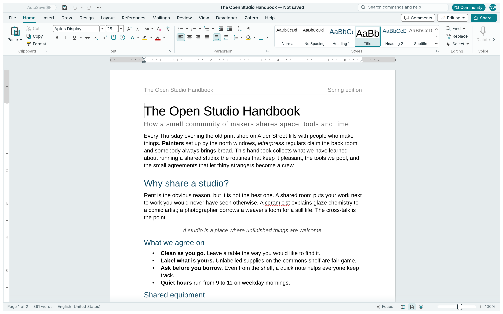
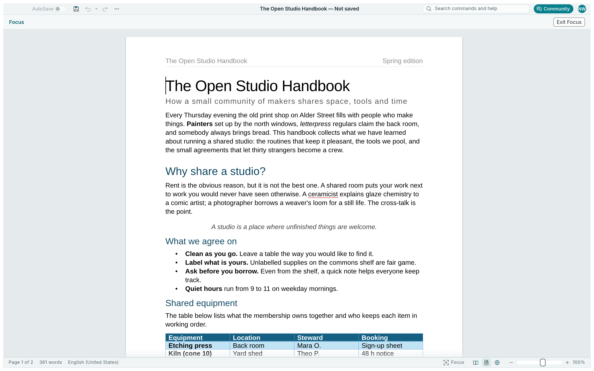

<p align="center">
  <picture>
    <source media="(prefers-color-scheme: dark)" srcset="docs/brand/not-word-logo-white.svg">
    
  </picture>
</p>

<h1 align="center">Not Word</h1>

<p align="center"><b>Your words. Your workspace. Your files.</b></p>

<p align="center">
  An independent, open-source word processor maintained by
  <a href="https://github.com/Itskorrah">Itskorrah</a>.<br>
  Native Rust · DOCX editing · Offline writing · CLI and MCP automation
</p>

<p align="center">
  <a href="https://github.com/Itskorrah/not-word"></a>
  <a href="LICENSE-MIT"></a>
  
</p>

Not Word brings a familiar document workflow to an open, local application: write and format,
work with tables and references, review changes, and export documents. The same command engine
powers the desktop interface, command-line tool and automation integrations.

This repository is an independent fork of [WordCraft](https://github.com/storytold/wordcraft).
Its upstream engineering and contributor history are retained. Not Word has its own identity
and maintenance direction; see [provenance and licensing](#provenance-and-licensing).

> **Alpha software.** Keep a backup of important documents and check exported or round-tripped
> files before sharing them. A command being available does not establish complete Microsoft
> Word compatibility. [Known limitations](#known-limitations) describe the remaining work.

<p align="center">
  <picture>
    <source media="(prefers-color-scheme: dark)" srcset="docs/images/not-word-dark.png">
    
  </picture>
  <br><sub>The real Not Word interface, captured with its offscreen UI harness.</sub>
</p>

## What you can do

| Workflow | Included capabilities |
|---|---|
| Write and organise | Rich text, styles, lists, headings, navigation, find and replace, undo and redo |
| Lay out a document | Page sizes and margins, sections, headers and footers, page numbers, columns, tables and pictures |
| Build reports and papers | Table of contents, footnotes and endnotes, captions, cross-references, citations and bibliography; local Zotero integration |
| Review | Comments, tracked changes, accept/reject, document comparison, spelling and grammar |
| Personalise | Light/dark/system themes, five accents, high contrast, six workspace presets, interface scaling, reduced animation and Quick Access Toolbar |
| Exchange files | DOCX read/write, legacy DOC import, ODT, RTF, HTML, Markdown, LaTeX and plain text; PDF and page-image export |
| Automate | Searchable commands, batch transformations, macros, structured document inspection, MCP and an authenticated local control channel |

The document engine and offline proofing run locally. Proofing coverage depends on language:
English is bundled; Polish and Brazilian Portuguese use installed Hunspell dictionaries.
The optional Zotero integration talks to the local Zotero desktop application.

## Make the workspace yours

Choose a writing, academic, professional, review or distraction-free arrangement, then adjust
the panes and toolbar to suit your work. Preferences retain the actual arrangement across
restarts. Five accents, high contrast, light/dark themes and independent interface scaling
keep the workspace flexible. [Customisation guide](docs/customization.md).

<table>
<tr>
<td width="50%" valign="top"><p><b>Your preferences.</b> Theme, accent, sizing and workspaces in one place.</p></td>
<td width="50%" valign="top"><p><b>Room to write.</b> Focus hides tools temporarily; Escape restores the workspace.</p></td>
</tr>
</table>

These are screenshots of the application, not mock-ups. The original sample text is inherited
from WordCraft; screenshot and artwork provenance are recorded in [ATTRIBUTION.md](ATTRIBUTION.md).

## Build and run

Use **Rust 1.95 or newer**, with Cargo, rustfmt and Clippy. The locked dependency graph requires
this toolchain even though earlier upstream documentation described an older minimum.
Desktop builds need the platform's native graphics/windowing libraries; see the
[development guide](docs/development.md) for Linux and cloud details.

```sh
git clone https://github.com/Itskorrah/not-word.git
cd not-word
cargo fetch --locked
cargo run --locked -p wordcraft --bin not-word -- --sample
```

Open an existing document:

```sh
cargo run --locked -p wordcraft --bin not-word -- report.docx
```

For an optimised desktop and command-line build:

```sh
cargo build --locked --release -p wordcraft --bin not-word
cargo build --locked --release -p wordcraft-cli --bin not-word-cli
```

The binaries are `target/release/not-word` and `target/release/not-word-cli` (with `.exe` on
Windows). Internal package and directory names remain `wordcraft-*` for compatibility. The
legacy `wordcraft` and `wordcraft-cli` binary aliases remain available.

Builds from this source checkout are the installation path documented here. Check this fork's
[releases page](https://github.com/Itskorrah/not-word/releases) for any published artifacts;
upstream downloads, signatures and installers do not establish a Not Word release.

### Browser development

Install the WebAssembly target and [Trunk](https://trunkrs.dev/), then serve the existing web app:

```sh
rustup target add wasm32-unknown-unknown
cd apps/wordcraft-web
trunk serve
```

Open <http://127.0.0.1:8771/?sample>. Browser file access, persistence and printing use browser
APIs and differ from desktop behavior. Interface preferences persist in browser storage;
document contents must be saved/exported explicitly. `cargo xtask wasm` checks portability of the shared
crates; it does not replace a browser smoke test or a production Trunk build.

## Command line and automation

After building, put `target/release` on your `PATH`, or use the full binary path:

```sh
not-word-cli convert report.docx report.pdf
not-word-cli info report.docx
not-word-cli inspect report.docx
not-word-cli run --template sample \
  --cmd 'select.text={"text":"Membership"}' --cmd format.bold --save out.docx
not-word-cli commands --json
```

The MCP server works without opening a window:

```sh
not-word-cli mcp --automation-read-root /work/documents --automation-write-root /work/output
```

Both folders must already exist. Read and write permissions are separate; supplying one grants
only that access. The running desktop application has a separate authenticated loopback
control channel:

```sh
not-word --control 7981
not-word-cli mcp --connect 127.0.0.1:7981
```

See the [CLI guide](docs/cli.md), [MCP tools and access boundaries](docs/mcp.md) and
[control protocol](docs/control-protocol.md). Automation can inspect document structure and
render pages to verify results.

## Development

```sh
cargo fmt --all -- --check
cargo clippy --workspace --all-targets -- -D warnings
cargo test --workspace
cargo xtask assets
cargo xtask layers
cargo xtask wasm
```

`cargo xtask ci` runs those six gates in order and stops at the first failure.
`cargo xtask parity` regenerates the feature catalog checklist; catalog coverage measures
registered commands, rather than their depth or file fidelity.

Start with [AGENTS.md](AGENTS.md), the [development guide](docs/development.md) and
[architecture](docs/architecture.md). Changes should include focused regression tests and
updated documentation. Original assets and all third-party materials need an entry in
[ATTRIBUTION.md](ATTRIBUTION.md).

## Known limitations

- DOCX fidelity still needs a representative, legally redistributable real-world corpus and
  comparison across editors. Preserving a package part does not imply rendering or editing it.
- Pagination, complex objects, fields and advanced typography can differ from Microsoft Word.
  Legacy DOC is an import format; DOC export is unsupported.
- Proofing language coverage is limited. Screen-reader, IME and platform-specific printing
  behavior need validation on the relevant systems.
- Native and browser builds share the engine but have different filesystem, clipboard and
  printing integrations. This fork does not inherit proof of signed or notarised releases.
- The inherited parity assessments include dated upstream estimates. They remain useful
  engineering context and are not fresh compatibility certification for this fork.

The [roadmap](ROADMAP.md), [ranked gaps](docs/gaps.md),
[file-format checklist](docs/file-format-parity.md) and
[parity assessment](docs/target-app-parity.md) retain the detailed evidence and open questions.

## Documentation

| Guide | Purpose |
|---|---|
| [Development](docs/development.md) | Prerequisites, cloud workflow, builds and verification |
| [Architecture](docs/architecture.md) | Crate boundaries, command model, document lifecycle |
| [Customisation](docs/customization.md) | Themes, interface preferences and automation settings |
| [CLI](docs/cli.md) · [MCP](docs/mcp.md) · [Control](docs/control-protocol.md) | Headless and desktop automation |
| [Zotero](docs/zotero.md) | Local citation integration and its limits |
| [Engineering log](docs/engineering-log.md) | Completed improvements and verification evidence |
| [Release guide](docs/releasing.md) | Packaging and fork-specific release prerequisites |
| [Contributors](docs/contributors.md) | Accurate, consent-based contributor credit |

## Provenance and licensing

Not Word is maintained by **Itskorrah** at
[github.com/Itskorrah/not-word](https://github.com/Itskorrah/not-word).
It derives from WordCraft by the ArtCraft Team and WordCraft contributors. Existing copyright,
license and contributor notices remain in place; this fork does not claim authorship of their
work or endorsement by the upstream project.

The code is licensed under [MIT](LICENSE-MIT) or [Apache-2.0](LICENSE-APACHE), at your option.
[NOTICE](NOTICE) records required notices, and [ATTRIBUTION.md](ATTRIBUTION.md) records asset
sources and licenses. The Not Word visual identity is original artwork for this fork.

Microsoft and Microsoft Word are trademarks of the Microsoft group of companies. Not Word is
independent and is not affiliated with, sponsored by or endorsed by Microsoft or the ArtCraft Team.
