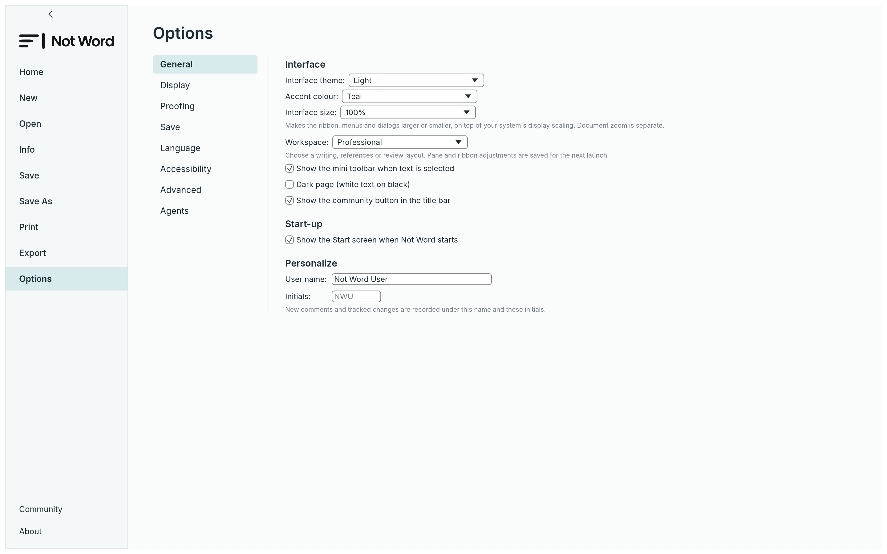

# Customising Not Word

Use **File › Options** for application preferences. Interface changes affect the workspace;
page colours, styles and other document design choices belong to the document itself.



## Appearance and editing preferences

- Choose system, light or dark appearance. System mode follows the platform's reported
  preference, with a light fallback when unavailable.
- Choose a teal, blue, violet, rose or amber accent, and enable high contrast for clearer
  interface boundaries and controls.
- Scale the interface from 80–200% independently of document zoom.
- Follow the system's animation preference or explicitly enable/disable animations. Caret
  animation can be controlled separately.
- Choose the interface language, start-screen behavior and author name for comments and
  tracked changes. Editing options include existing AutoCorrect/AutoFormat and display choices.
- Customise Quick Access Toolbar commands and use keytips for keyboard access. View commands
  control the navigation pane, rulers, formatting marks, focus mode and document zoom.

## Workspace presets

Presets make a coherent arrangement of the existing ribbon, rulers and panes. They change
interface state rather than document formatting:

| Preset | Arrangement |
|---|---|
| Writing (`writing`) | Home tab, collapsed ribbon, rulers and side panes hidden |
| Academic (`academic`) | References tab, expanded ribbon, rulers, navigation and styles panes |
| Professional (`professional`) | Home tab, expanded ribbon and rulers; side panes hidden |
| Editing and Review (`review`) | Review tab, expanded ribbon, rulers, navigation and comments |
| Distraction-Free (`focus`) | Focus mode hides ribbon, rulers and panes; Exit Focus/Escape restores the previous arrangement |
| Custom (`custom`) | Retains your current arrangement |

Choose a preset in Options or through the command interface. Writing, Academic, Professional
and Review return from Read Mode or Outline to editing Print Layout so the selected ribbon
is available; Focus and Custom preserve the current view mode. The actual arrangement is saved
with preferences, so a restart restores subsequent pane/ribbon choices rather than applying
the preset from scratch. Focus mode preserves the choices it temporarily hides.

## Proofing dictionaries

English proofing is bundled. Native Polish and Brazilian Portuguese proofing read installed
Hunspell dictionary pairs (`.aff` and `.dic`). To supply a custom dictionary directory, set
`NOT_WORD_DICTIONARIES` to that one directory before starting the app; the legacy
`WORDCRAFT_DICTIONARIES` override remains accepted when the primary value is absent/empty.
Windows searches the new `NotWord/dictionaries` folders and retains legacy
`WordCraft/dictionaries` locations. These are local dictionaries; no service key is needed.
The browser cannot discover dictionaries in the host filesystem.

## Automation

The desktop control channel exposes the same UI preferences:

```json
{"method":"engine.execute","params":{"command":"ui.theme","params":{"value":"dark"}}}
{"method":"engine.execute","params":{"command":"ui.accent","params":{"value":"violet"}}}
{"method":"engine.execute","params":{"command":"ui.highContrast","params":{"value":true}}}
{"method":"engine.execute","params":{"command":"ui.workspace","params":{"value":"academic"}}}
{"method":"engine.execute","params":{"command":"ui.interfaceSize","params":{"percent":115}}}
{"method":"engine.execute","params":{"command":"ui.animations","params":{"value":"off"}}}
{"method":"engine.execute","params":{"command":"ui.caretAnimation","params":{"value":false}}}
{"method":"engine.execute","params":{"command":"ui.startScreen","params":{"value":false}}}
```

Send the per-window authentication key with real control requests; it is omitted above to
keep the examples shareable. `engine.commands` supplies current command and parameter details;
[control-protocol.md](control-protocol.md) documents the transport.

## Persistence

The desktop stores UI preferences in `ui.json` under its settings directory:

| Platform | Settings folder |
|---|---|
| Linux/BSD | `$XDG_CONFIG_HOME/not-word`, or `~/.config/not-word` |
| macOS | `~/Library/Application Support/Not Word` |
| Windows | `%APPDATA%\NotWord` |

The persisted UI fields include `accent`, `highContrast`, `workspace` and `workspaceLayout`.
Layout stores focus, rulers, navigation, styles and comments state. The existing loader handles
fields independently: invalid/missing appearance or layout values fall back safely without
throwing away unrelated valid preferences. There is no new whole-file schema version yet.

The browser loads interface preferences from the versioned `not-word.ui.v1` storage key
and saves changes every five seconds. It uses the same tolerant field decoding with a 2 MiB
preference budget and skips unchanged writes. This record does not save or recover document
contents. Save/export your document explicitly before leaving the browser. Clearing site data
can remove preferences and user-added fonts.

Do not edit preferences while the application is running: its next save can replace the file.

Internal identifiers retained for compatibility do not change the product name. Keep a backup
of preferences before manually moving data between builds. Existing upstream settings are
read from the legacy folder only when the corresponding Not Word file is absent. This
applies to UI/window preferences and the custom dictionary; new writes use the Not Word folder
and leave the legacy file intact. User-added fonts load from both folders without moving or
deleting them. Native preference writes use the engine's atomic-write helper.

For isolated test runs, `NOT_WORD_NO_PREFS` disables native preference reads/writes and
file logs; `WORDCRAFT_NO_PREFS` remains accepted for compatibility.
